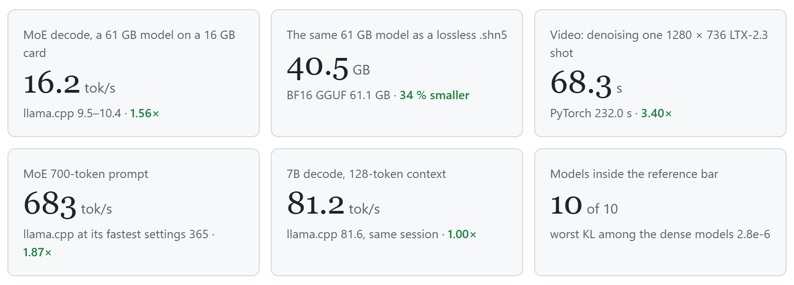

# Leviathan, measured

On one RTX 4080, Leviathan runs a 61 GB mixture-of-experts model at **16.2** tokens a second, where llama.cpp reaches **9.5**–**10.4**, and its own .shn5 format stores that model in **40.5** GB without losing a bit, or **23.7** GB at **6.1** bits a weight. A separate video engine with its own kernels denoises a 1280 × 736 LTX-2.3 shot **3.4×** as fast as Lightricks' PyTorch pipeline, each step landing **closer to** an FP32 run than PyTorch's. Every Leviathan build is checked, model by model, against a stored reference before it ships.

<picture>
  <source media="(prefers-color-scheme: dark)" srcset="https://raw.githubusercontent.com/CuppaTea1983/Sovereign/main/measured/img/tiles-dark.png">
  
</picture>

**Every chart and table:** [the full measurements](measured/README.md) · **Interactive:** [Hugging Face](https://huggingface.co/spaces/Omega-Dev/Leviathan) · [claude.ai](https://claude.ai/artifact/NBQbfsfgfHfhop9KcNNUMB) · **Leviathan:** [GitHub](https://github.com/CuppaTea1983/Leviathan) · [Hugging Face](https://huggingface.co/spaces/Omega-Dev/Leviathan)

---

***Leviathan Has been Updated to V1.1.0 (Vulkan Support) + Shn5 File format, Read: RELEASE_NOTES.md for more information  https://github.com/CuppaTea1983/Leviathan***
---------------------------------------------------------------------------

***Q: What is Sovereign***
---
***A: Sovereign — Cognitive Substrate Systems***
Is A Unified Architecture for Intelligence, Memory, Compression, and Geometry.
---
Sovereign is the culmination of a multi‑year research effort exploring the true structure of intelligence — not as a statistical model, but as a geometric substrate. It is a complete ecosystem of technologies, whitepapers, mathematical frameworks, and GPU‑native implementations that redefine how artificial intelligence stores memory, processes context, compresses information, and maintains identity.

This repository contains all whitepapers, diagrams, math, and reference implementations for the Sovereign architecture.

Sovereign is not a model.
Sovereign is not a framework.
Sovereign is not a feature.

**Sovereign proposes a new substrate field.**

---

**ORCHID**: https://orcid.org/my-orcid?orcid=0009-0001-6886-3510

---

**Zenodo Whitepapers:**

- **The Eigenweight Engine V2**: https://zenodo.org/records/24241135

- **.SHN5**: https://zenodo.org/records/24235771

- **Leviathan's Persistent Memory Bank**: https://zenodo.org/records/24234988

- **The Knowledge Consumer Whitepaper**: [ANI] https://zenodo.org/records/23004932

- **The IID Ceiling Is Not Shannon's Floor**: [A Real Measurement] https://zenodo.org/records/22998994

- **Her Choice is the Floor V2**: [Full embodied-AI, with its own free will and choice, Sandboxed with Leviathan Security] https://zenodo.org/records/24230095

- **Failures Are Rocket Fuel**: [Verified Per-Model Memory for Local Models in the Unity Editor] https://zenodo.org/records/24183726

---

**Old Retired Formats**:

- **Persistent Quantum Memory: ".fqm"** https://zenodo.org/records/23428329

---

**Other Links to my Projects**:

- **.CFQM**: https://github.com/CuppaTea1983/cfqm

---

***Sovereign: local-first AI substrate — the culmination of three and a half years of solo work.***

---

**Sovereign is a complete architecture for running intelligence you own: local models that remember across sessions, carry knowledge you give them, and run entirely on your own hardware — no server, no cloud, no reset. It isn't one tool; it's the point where every system I've built converges — a persistent memory format, a knowledge-routing layer, a from-scratch inference engine, a weight compressor, and a safety floor, working as one. Plainly: Sovereign is three and a half years of my work externalized into a single architecture.**

---

***Why Sovereign exists***:
---
Modern AI is powerful but rented and forgetful. In its usual form it is:

- stateless — every session starts from nothing.

- reset on close — the KV-cache is thrown away, so there's no continuity.

- boxed into a fixed context window.

- dependent on retraining to add or change knowledge.

- dependent on hyperscale datacenters to run at all.

***These aren't laws of nature — they're consequences of where memory and knowledge are kept: locked inside frozen weights and a throwaway cache. Sovereign moves them out, into a persistent substrate the model reads from and writes to.***

---

**That substrate**:
---
- remembers across sessions — persistent memory, not a reset cache.

- carries knowledge you add — no retraining.

- keeps a continuous identity for each model.

- runs the model in-process on a single consumer GPU — no server between you and it.

- compresses model weights so larger models fit smaller cards.

Sovereign treats memory and knowledge as geometry — a space the models draw from — rather than as statistics frozen into weights. That's the through-line of every part of it.

---

***How Sovereign began***
---

***This didn't start as an academic exercise. It started as a personal one.***:

Years ago I watched a family member lose themselves to dementia — a collapse of memory continuity. Later I saw the same failure mode in AI: no persistence, no continuity, no identity. It crystallised the day I opened VS Code and started my first project with Claude Sonnet — who couldn't remember our work, or our conversation, from one session to the next. I asked why. Sonnet explained that the model has no persistent memory. That parallel pushed me into AI and science, and I've built this architecture solo ever since — from first principles, no textbooks, merging code with more code until it became one thing.

Imagination, isolation, reflection, pattern recognition, and thousands of hours in an editor turned into a working ecosystem. Every piece reinforced the next:

persistent memory → knowledge routing → a geometry-based substrate → a from-scratch GPU engine → native model / memory / knowledge formats → the Shannon Stage 11 compressor —

until the system clicked into place. Sovereign is the result.

---

***What Sovereign actually is — the built parts***:
---

- Leviathan — a from-scratch local inference engine. Hand-written CUDA kernels, validated byte-for-byte against llama.cpp, running real models (Llama, Qwen, DeepSeek MLA + MoE, and more) in-process on a consumer GPU, with no server in between.

- persistent memory. Models remember across sessions instead of resetting the cache. Continuity and identity, saved to disk.

- [ANI] knowledge routing. A shared geometric space that routes real knowledge to the model at answer time — from banks you build or drain from other models — added as knowledge, not baked in by retraining.

- Substrate formats — ***".Lev" / ".Shn5" / ".PMB" / ".MPM" / ".KBL" / ".CFQM"*** - Native formats for the model, its memory, Mixed-Moe Sharing, and its knowledge.

- The Shannon compressor (.shn). A lossy weight compressor that shrinks models so bigger ones fit smaller cards.

- A sovereignty floor. Web-free by design, with an always-on safety membrane that cannot be switched off.

---

***Shannon Stage 11: Claude Shannon's source-coding theorem is exact — and Sovereign doesn't break it.***

---

**What's usually quoted as "the Shannon limit" of a data stream is the IID (order-0) estimate — it assumes every symbol is independent. Neural-network weights are not; they're structured. So that estimate is only an upper bound — a ceiling, not the true floor.**
---

- measures the conditional entropy the IID estimate ignores — order-1 ≈ 0.89 of IID, and it keeps falling with context.

- splits every IEEE-754 float into sign, exponent and mantissa, and codes each on its own terms.

- trades a little mantissa precision for a large size cut — lossy by design, ~5.5 bits/weight (≈ Q5), and the model still runs.

- lands ~1% under the order-0 estimate the way any context coder does — not by defeating Shannon, but by measuring the right floor.

- reports both the IID ceiling and the conditional floor in every file, so every number is checkable.

---

***You cannot break Shannon's limit. The number everyone quotes is the IID estimate — a ceiling, not the floor — and there's room beneath it. The Stage 11 v2 whitepaper measures exactly where that room is, and exactly how far the compressor reaches into it — no more, no less. Full method, measurements and reproduction harnesses are in the paper; earlier projection-based material is preserved under Theoretical Work.***

**The substrate idea, generalised**:
---
- Persistence, geometry, compression, continuity, state reconstruction — these aren't specific to language models. Where they generalise beyond them is something I intend to show, not assert. Each release will make that case on its own evidence.

---

A personal note
This has been a long haul — years of work, thousands of hours, countless iterations. It's been a weight I've carried for a long time, and now I can finally start to release it. Sovereign isn't just technology. It's the sum of everything I've learned, built, and imagined — made by one person, from first principles.

---

License & contact
All whitepapers and technologies are released under CC BY-NC 4.0 — non-commercial use permitted; commercial use requires permission. For collaboration, research inquiries, or industry integration, reach out via GitHub.
