# Leviathan, measured

**Interactive version**, every chart live with its tooltips: [Hugging Face](https://huggingface.co/spaces/Omega-Dev/Leviathan-Measured) · [claude.ai](https://claude.ai/artifact/NBQbfsfgfHfhop9KcNNUMB)  
**Leviathan**: [GitHub](https://github.com/CuppaTea1983/Leviathan) · [Hugging Face](https://huggingface.co/spaces/Omega-Dev/Leviathan) · **Sovereign**: [GitHub](https://github.com/CuppaTea1983/Sovereign)

On one RTX 4080, Leviathan runs a 61 GB mixture-of-experts model at **16.2** tokens a second, where llama.cpp reaches **9.5**–**10.4**, and its own .shn5 format stores that model in **40.5** GB without losing a bit, or **23.7** GB at **6.1** bits a weight. A separate video engine with its own kernels denoises a 1280 × 736 LTX-2.3 shot **3.4×** as fast as Lightricks' PyTorch pipeline, each step landing **closer to** an FP32 run than PyTorch's. Every Leviathan build is checked, model by model, against a stored reference before it ships.

<picture>
  <source media="(prefers-color-scheme: dark)" srcset="https://raw.githubusercontent.com/CuppaTea1983/Sovereign/main/measured/img/tiles-dark.png">
  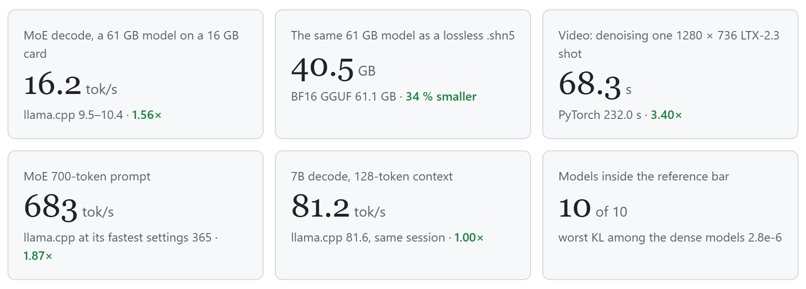
</picture>

## A model bigger than the card

Qwen3-30B-A3B in BF16 is 61 GB; the RTX 4080 holds 16. Leviathan keeps the always-used weights on the card, streams each layer's experts in from RAM as the router picks them, and runs the whole prompt in one fp32 pass so each expert crosses PCIe once. llama.cpp runs the same model with its experts on the CPU (`--cpu-moe`). Higher is better.

### Decode, tokens a second

<picture>
  <source media="(prefers-color-scheme: dark)" srcset="https://raw.githubusercontent.com/CuppaTea1983/Sovereign/main/measured/img/moe-decode-dark.png">
  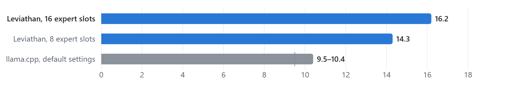
</picture>

### 700-token prompt, tokens a second

<picture>
  <source media="(prefers-color-scheme: dark)" srcset="https://raw.githubusercontent.com/CuppaTea1983/Sovereign/main/measured/img/moe-prompt-dark.png">
  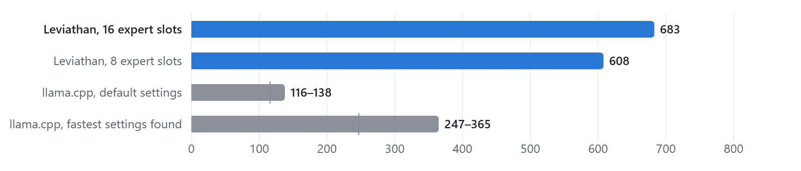
</picture>

Measured by the test harness, the same 700 token ids for both engines, llama.cpp timed by its own clock: Leviathan's decode and 700-token figures on 2026-11-14, its 2,048-token figure and every llama.cpp figure on 2026-11-13. Where llama.cpp shows a range, the bar is its best run and the table lists both. Its fastest settings were `-b 2048 -ub 2048 --no-mmap -fa on`. At 2,048 tokens: Leviathan 1,234, llama.cpp 801 tok/s. In fp32 the prompt pass comes within 6.5e-5 nats of a float64 reference built from the model's own weights.

Table

| Engine | VRAM, GiB | Decode low | Decode | 700 prompt low | 700 prompt | 2,048 prompt | Settings |
| --- | ---: | ---: | ---: | ---: | ---: | ---: | --- |
| Leviathan, 16 expert slots | 10.3 | — | 16.2 | — | 683 | 1234 | expert streaming from pinned RAM, 16 slots a layer, full fp32 prompt pass |
| Leviathan, 8 expert slots | 6.9 | — | 14.3 | — | 608 | — | expert streaming from pinned RAM, 8 slots a layer |
| llama.cpp, default settings | — | 9.5 | 10.4 | 116 | 138 | — | CUDA build, --cpu-moe (experts in RAM), its own timer |
| llama.cpp, fastest settings found | — | — | — | 247 | 365 | 801 | CUDA build, --cpu-moe -b 2048 -ub 2048 --no-mmap -fa on, f16 KV cache |

## The same model in fewer bytes

Leviathan's own file format, .shn5, stores BF16 weights without loss: the exponents are entropy-coded, the sign and mantissa kept as they are. A mixture-of-experts model's experts stay compressed in RAM, and the card decodes each one as it streams in, checking every 4,096-weight tile. Stage 10, the lossy level, quantises each matrix around a per-row and per-column scale grid before the same coding; the norms, the router, the embeddings and the output head stay lossless. Stage 10 came after the 1.1.0 release. Smaller is better.

<picture>
  <source media="(prefers-color-scheme: dark)" srcset="https://raw.githubusercontent.com/CuppaTea1983/Sovereign/main/measured/img/shn5-sizes-dark.png">
  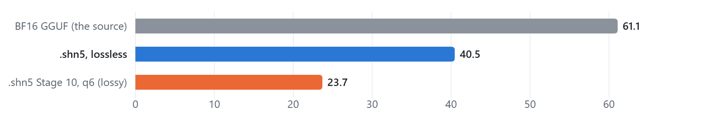
</picture>

Qwen3-30B-A3B: the lossless file is 34 % smaller than the BF16 GGUF and decodes to its exact bytes, checked tensor by tensor; at q6, Stage 10 is 61 % smaller.

### Decode, tokens a second

<picture>
  <source media="(prefers-color-scheme: dark)" srcset="https://raw.githubusercontent.com/CuppaTea1983/Sovereign/main/measured/img/shn5-decode-dark.png">
  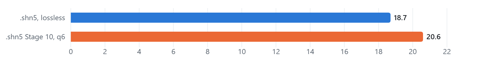
</picture>

### 2,048-token prompt, tokens a second

<picture>
  <source media="(prefers-color-scheme: dark)" srcset="https://raw.githubusercontent.com/CuppaTea1983/Sovereign/main/measured/img/shn5-prompt-dark.png">
  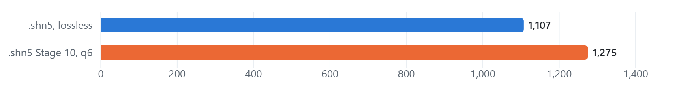
</picture>

Higher is better. Fewer bytes to stream make the lossy file faster as well: decode +10 % and a 2,048-token prompt +15 %, with 20.6 GB of RAM held for the experts instead of 35.8, and a load of 8.2 s instead of 14.4. Measured on 2026-11-16 in one session, the two files alternated, 16 expert slots a layer. The card's clock varies by session, which is why the lossless file decodes at 18.7 tok/s here and at 16.2 in the section above (2026-11-14).

### What Stage 10 costs, beside llama.cpp's Q6\_K

<picture>
  <source media="(prefers-color-scheme: dark)" srcset="https://raw.githubusercontent.com/CuppaTea1983/Sovereign/main/measured/img/shn5-quality-dark.png">
  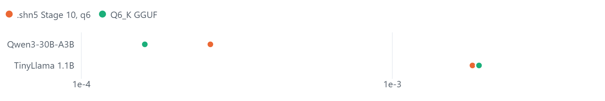
</picture>

KL divergence from each model's reference, in nats; lower is closer. On TinyLlama 1.1B, where the q6 level was set, Stage 10 lands as close as Q6\_K with 7.1 % fewer bits a weight. On the 30B it uses 6.8 % fewer bits and lands a little further from its reference (2.6e-4 against 1.6e-4), with the same top token at every position checked: the level needs setting for each model, which is the next step.

Tables

| File | Size, GB | Bits a weight | Lossless |
| --- | ---: | ---: | --- |
| BF16 GGUF (the source) | 61.10 | 16 | yes |
| .shn5, lossless | 40.46 | — | yes |
| .shn5 Stage 10, q6 (lossy) | 23.69 | 6.113 | no |

| File | Decode, tok/s | 2,048 prompt, tok/s | RAM for the experts, GB | Load, s |
| --- | ---: | ---: | ---: | ---: |
| .shn5, lossless | 18.7 | 1,107 | 35.8 | 14.4 |
| .shn5 Stage 10, q6 | 20.6 | 1,275 | 20.6 | 8.2 |

| Model | File | Bits a weight | KL | Against | Note |
| --- | --- | ---: | ---: | --- | --- |
| Qwen3-30B-A3B | .shn5 Stage 10 q6 | 6.113 | 2.6e-4 | float64 reference of the BF16 model | top-1 36 of 36 |
| Qwen3-30B-A3B | Q6\_K GGUF | 6.5625 | 1.6e-4 | float64 reference of the BF16 model | embeddings and output head BF16 in both |
| TinyLlama 1.1B | .shn5 Stage 10 q6 | 6.096 | 1.8e-3 | the F16 model, teacher-forced | weight error 1.81 %, Q6\_K's |
| TinyLlama 1.1B | Q6\_K GGUF | 6.5625 | 1.9e-3 | the F16 model, teacher-forced | — |

## A video model on the same card

LTX-2.3 is a 22-billion-parameter diffusion transformer that makes picture and sound together. This is a community FP8 checkpoint of it, too big for the 16 GB card, so its weights stream in from RAM at every step. Through Lightricks' own PyTorch pipeline, one 1280 × 736 shot of 113 frames takes 232.0 s to denoise. Leviathan's video engine runs the same checkpoint on its own kernels, with the four guidance passes of each step batched into one call; each bar below adds one change to the bar above it. Lower is better.

<picture>
  <source media="(prefers-color-scheme: dark)" srcset="https://raw.githubusercontent.com/CuppaTea1983/Sovereign/main/measured/img/dit-ladder-dark.png">
  
</picture>

With exact f32 sums the engine already takes 145.9 s, 1.59× PyTorch's speed; the rest comes from cheaper arithmetic, and the charts below show what that costs. The times are the denoising alone, from each render's own record (2026-11-17); the text encoder, the decode and writing the file come on top. The video engine is a research build, separate from the Leviathan app, which runs text models.

### One step against FP32

<picture>
  <source media="(prefers-color-scheme: dark)" srcset="https://raw.githubusercontent.com/CuppaTea1983/Sovereign/main/measured/img/dit-accuracy-dark.png">
  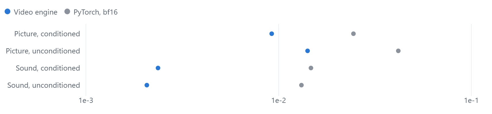
</picture>

Relative error of one real denoising step's outputs (768 × 512, 89 frames, picture and sound made from a prompt) from Lightricks' own blocks run in FP32 on the same inputs; lower is closer. The engine's default lands 2.7× closer than PyTorch's bf16 for the picture and 6.2× for the sound, in the conditioned pass (2026-11-18).

### The same video? Frames against the exact engine

<picture>
  <source media="(prefers-color-scheme: dark)" srcset="https://raw.githubusercontent.com/CuppaTea1983/Sovereign/main/measured/img/dit-psnr-dark.png">
  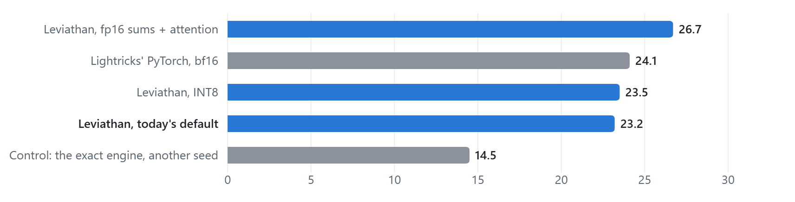
</picture>

PSNR of every decoded frame of the 1280 × 736 shot against the exact engine's render at the same seed; higher is closer. Another seed, a different video, sits at 14.5 dB. Today's default sits at 23.2 dB, a little further than PyTorch's own bf16 at 24.1: a diffusion model carries the last bit of any arithmetic through its steps, so no two maths paths match pixel for pixel, and here the frames show the same scene, character and motion.

### Where a step's time goes

<picture>
  <source media="(prefers-color-scheme: dark)" srcset="https://raw.githubusercontent.com/CuppaTea1983/Sovereign/main/measured/img/dit-profile-dark.png">
  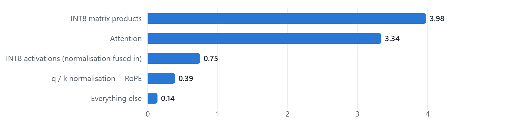
</picture>

GPU time of one denoising step at 1280 × 736, four guidance passes: 8.60 s in all, from a profiler trace taken before the last change on the ladder, which then took about 0.35 s a step off the matrix products.

### A prompt in, picture and sound out

LTX-2.3 also makes its own sound, 48 kHz stereo. On the engine's default, with Lightricks' 2.3 guidance for both, from the prompt to the MP4 written (2026-11-18); the whole run includes building the engine, and the prompt's text encoding was cached.

| Size | Clip, s | Denoising, s | Decode, s | Whole run, s |
| --- | ---: | ---: | ---: | ---: |
| 768 x 512 | 3.0 | 19.8 | 2.8 | 38.5 |
| 1280 x 736 | 5.0 | 77.6 | 7.8 | 86.2 |

Tables

| Step | Change | Denoising, s |
| --- | --- | ---: |
| 1 | Lightricks' own PyTorch pipeline (bf16, weights streamed) | 232.0 |
| 2 | Leviathan DiT engine, exact (f32 sums; the 4 guidance passes in one call) | 145.9 |
| 3 | + fp16-accumulate matrix products | 117.3 |
| 4 | + fp16 attention | 105.4 |
| 5 | + the widest layer summed in fp16 chains | 99.4 |
| 6 | + a leaner attention loop (same bits) | 95.4 |
| 7 | + INT8 matrix products (W8A8: scale grid, Hadamard rotation, rank-32 correction) | 80.9 |
| 8 | + the widest layer in INT8 too | 72.1 |
| 9 | + the normalisation fused into the INT8 step | 70.0 |
| 10 | + the residual prefetched into L2 (same bits) | 68.3 |

| Output | Pass | Video engine | PyTorch |
| --- | --- | ---: | ---: |
| picture | conditioned | 9.2e-3 | 2.4e-2 |
| picture | unconditioned | 1.4e-2 | 4.2e-2 |
| sound | conditioned | 2.4e-3 | 1.5e-2 |
| sound | unconditioned | 2.1e-3 | 1.3e-2 |

| Render | PSNR, dB | Denoising, s |
| --- | ---: | ---: |
| Leviathan, fp16 sums + attention | 26.7 | 95.4 |
| Lightricks' PyTorch, bf16 | 24.1 | 232.0 |
| Leviathan, INT8 | 23.5 | 80.9 |
| Leviathan, today's default | 23.2 | 68.3 |
| Control: the exact engine, another seed | 14.5 | 145.0 |

| Part | GPU seconds a step |
| --- | ---: |
| INT8 matrix products | 3.98 |
| Attention | 3.34 |
| INT8 activations (normalisation fused in) | 0.75 |
| q / k normalisation + RoPE | 0.39 |
| Everything else | 0.14 |

## Decoding a 7B model that fits the card

Qwen 2.5 Coder 7B at Q8\_0, one token at a time after a prompt of 128, 2,048 or 4,096 tokens. Both engines ran back to back in the same session, in two interleaved rounds; each bar is that engine's faster round. Leviathan keeps the activations and the attention cache in fp32; llama.cpp rounds the activations to int8 before each matrix product and keeps its cache in fp16. Higher is better.

<picture>
  <source media="(prefers-color-scheme: dark)" srcset="https://raw.githubusercontent.com/CuppaTea1983/Sovereign/main/measured/img/dense-decode-dark.png">
  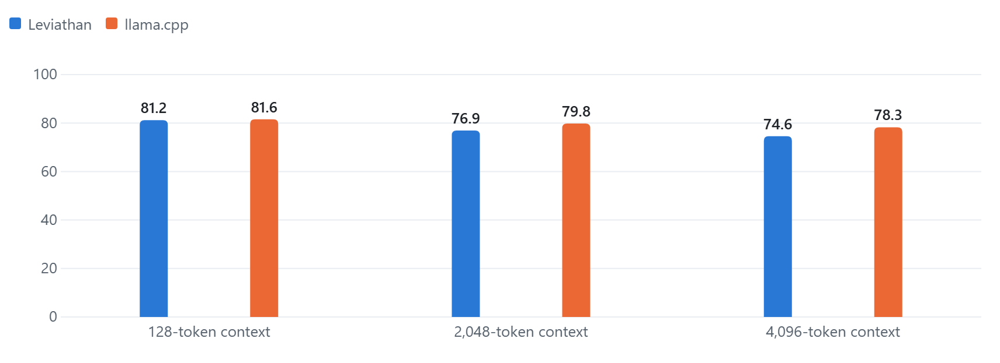
</picture>

From a 128- to a 4,096-token context, Leviathan's token takes 1.09 ms longer and llama.cpp's 0.52 ms. Leviathan keeps the attention cache in fp32, twice llama.cpp's fp16 bytes: at 4,096 tokens each token reads 472.5 MB of keys and values, which its attention streams at 382 GB/s (57 % of the card's read ceiling, Nsight Systems). Half those bytes at that speed would save about 0.62 ms a token, about the whole 0.57 ms difference. An fp16 cache is not built; it would be an opt-in, at llama.cpp's precision.

Table

| Engine | Context | tok/s | ms a token | Round 1 | Round 2 |
| --- | ---: | ---: | ---: | ---: | ---: |
| Leviathan | 128 | 81.17 | 12.32 | 81.07 | 81.17 |
| llama.cpp | 128 | 81.56 | 12.26 | 81.56 | 81.31 |
| Leviathan | 2,048 | 76.94 | 13.00 | 76.14 | 76.94 |
| llama.cpp | 2,048 | 79.80 | 12.53 | 79.43 | 79.80 |
| Leviathan | 4,096 | 74.57 | 13.41 | 72.03 | 74.57 |
| llama.cpp | 4,096 | 78.26 | 12.78 | 78.24 | 78.26 |

## Prompts on the same 7B model: llama.cpp still leads by default

A prompt runs as matrix multiplications on the tensor cores. Leviathan's default feeds them fp16; llama.cpp feeds int8, which this card runs four times as fast. Leviathan's two opt-in switches trade precision for speed and are off unless the user turns them on. Higher is better.

<picture>
  <source media="(prefers-color-scheme: dark)" srcset="https://raw.githubusercontent.com/CuppaTea1983/Sovereign/main/measured/img/prompts-dark.png">
  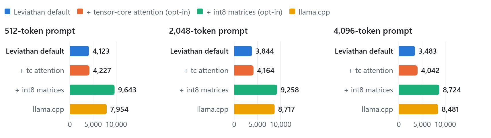
</picture>

With both switches on, the matrix inputs are int8 like llama.cpp's, and Leviathan's prompts run at 1.21×, 1.06× and 1.03× llama.cpp's speed at 512, 2,048 and 4,096 tokens.

What each arm costs, on the 2,048-token prompt's last position against Leviathan's exact path (fp32 matrix-vector products, no tensor cores): default KL 1.7e-7, tensor-core attention 4.5e-7, int8 matrices 8.4e-5 (KL in nats, lower is closer to exact; one position, where the reference check below takes the worst of 100).

Table

| Arm | Prompt | tok/s | KL vs exact | Matrix inputs |
| --- | ---: | ---: | ---: | --- |
| Leviathan default | 512 | 4,123 | — | fp16 inputs, fp32 sums; attention fp32 |
| Leviathan default | 2,048 | 3,844 | 1.7e-7 | fp16 inputs, fp32 sums; attention fp32 |
| Leviathan default | 4,096 | 3,483 | — | fp16 inputs, fp32 sums; attention fp32 |
| Leviathan + tensor-core attention (opt-in) | 512 | 4,227 | — | fp16 inputs, fp32 sums; attention fp16 inputs |
| Leviathan + tensor-core attention (opt-in) | 2,048 | 4,164 | 4.5e-7 | fp16 inputs, fp32 sums; attention fp16 inputs |
| Leviathan + tensor-core attention (opt-in) | 4,096 | 4,042 | — | fp16 inputs, fp32 sums; attention fp16 inputs |
| Leviathan + int8 matrices + tc attention (opt-in) | 512 | 9,643 | — | int8 activations per 32 with exact Q8\_0 weights; attention fp16 inputs |
| Leviathan + int8 matrices + tc attention (opt-in) | 2,048 | 9,258 | 8.4e-5 | int8 activations per 32 with exact Q8\_0 weights; attention fp16 inputs |
| Leviathan + int8 matrices + tc attention (opt-in) | 4,096 | 8,724 | — | int8 activations per 32 with exact Q8\_0 weights; attention fp16 inputs |
| llama.cpp (flash attention on) | 512 | 7,954 | — | int8 activations per 32 (its MMQ kernels); flash attention f16 |
| llama.cpp (flash attention on) | 2,048 | 8,717 | — | int8 activations per 32 (its MMQ kernels); flash attention f16 |
| llama.cpp (flash attention on) | 4,096 | 8,481 | — | int8 activations per 32 (its MMQ kernels); flash attention f16 |

## Every model, checked against a stored reference

Before a build ships, each model is run teacher-forced over four prompts, 25 positions each, and compared position by position with the RTX 4080's recorded output. A model passes when the top token matches (or the top two are tied within 0.01 nats) and the KL divergence stays under its bar everywhere; the same comparison one step out of line must fail, and does, for every model. The chart is the CUDA engine now live; the Vulkan engine passed the same check on this card and on an AMD integrated GPU (2026-11-14). Lower is better; the line marks each model's bar.

<picture>
  <source media="(prefers-color-scheme: dark)" srcset="https://raw.githubusercontent.com/CuppaTea1983/Sovereign/main/measured/img/reference-dark.png">
  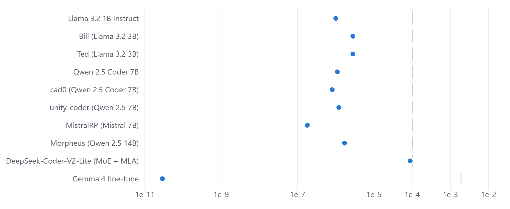
</picture>

Table

| Model | Weights | Worst KL | Bar | Decode path |
| --- | --- | ---: | ---: | --- |
| Llama 3.2 1B Instruct | Q6\_K | 1.0e-6 | 1.0e-4 | graph + grouped attention |
| Bill (Llama 3.2 3B) | F16 | 2.8e-6 | 1.0e-4 | graph + grouped attention |
| Ted (Llama 3.2 3B) | F16 | 2.8e-6 | 1.0e-4 | graph + grouped attention |
| Qwen 2.5 Coder 7B | Q8\_0 | 1.1e-6 | 1.0e-4 | graph + grouped attention |
| cad0 (Qwen 2.5 Coder 7B) | Q8\_0 | 8.1e-7 | 1.0e-4 | graph + grouped attention |
| unity-coder (Qwen 2.5 7B) | Q8\_0 | 1.2e-6 | 1.0e-4 | graph + grouped attention |
| MistralRP (Mistral 7B) | Q8\_0 | 1.8e-7 | 1.0e-4 | graph + grouped attention |
| Morpheus (Qwen 2.5 14B) | Q4\_K\_M | 1.7e-6 | 1.0e-4 | graph + grouped attention |
| DeepSeek-Coder-V2-Lite (MoE + MLA) | Q6\_K | 8.9e-5 | 1.0e-4 | its own MLA attention |
| Gemma 4 fine-tune | Q8\_0 | 2.9e-11 | 1.9e-3 | its own forward |

## What the two opt-in switches cost

The same check with each switch on. Tensor-core attention stays far inside the bar on every model it applies to. int8 matrices, llama.cpp's own precision for prompts, cross it on every Q8\_0 model, and on the Gemma 4 fine-tune they change the top token twice: that is why both stay off by default. Lower is better.

<picture>
  <source media="(prefers-color-scheme: dark)" srcset="https://raw.githubusercontent.com/CuppaTea1983/Sovereign/main/measured/img/optin-dark.png">
  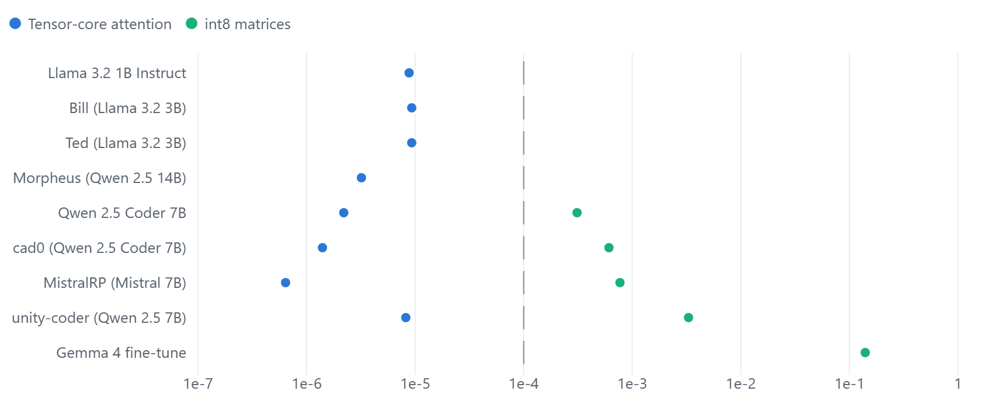
</picture>

Table

| Model | Weights | Tensor-core attention | int8 matrices |
| --- | --- | ---: | ---: |
| Llama 3.2 1B Instruct | Q6\_K | 8.8e-6 | n/a |
| Bill (Llama 3.2 3B) | F16 | 9.3e-6 | n/a |
| Ted (Llama 3.2 3B) | F16 | 9.3e-6 | n/a |
| Morpheus (Qwen 2.5 14B) | Q4\_K\_M | 3.2e-6 | n/a |
| Qwen 2.5 Coder 7B | Q8\_0 | 2.2e-6 | 3.1e-4 |
| cad0 (Qwen 2.5 Coder 7B) | Q8\_0 | 1.4e-6 | 6.1e-4 |
| MistralRP (Mistral 7B) | Q8\_0 | 6.4e-7 | 7.7e-4 |
| unity-coder (Qwen 2.5 7B) | Q8\_0 | 8.2e-6 | 3.3e-3 |
| Gemma 4 fine-tune | Q8\_0 | — | 1.4e-1 |

## Under the hood of a decode step

A decode step reads every weight once, so it is bound by how fast memory streams. Leviathan's matrix-vector products now take about as long as llama.cpp's while keeping fp32 activations, and the step runs as fewer, larger kernels, replayed as one CUDA graph a token as llama.cpp's is.

### Kernels a decode token

<picture>
  <source media="(prefers-color-scheme: dark)" srcset="https://raw.githubusercontent.com/CuppaTea1983/Sovereign/main/measured/img/launches-dark.png">
  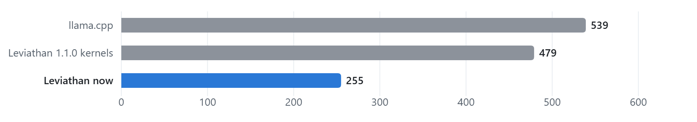
</picture>

### How fast each weight streams, of the card's 670 GB/s ceiling

<picture>
  <source media="(prefers-color-scheme: dark)" srcset="https://raw.githubusercontent.com/CuppaTea1983/Sovereign/main/measured/img/bandwidth-dark.png">
  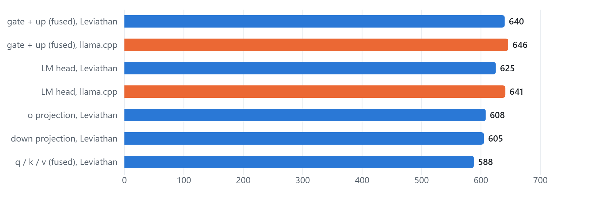
</picture>

Matrix-vector time a token, Nsight Systems, the two engines traced back to back: Leviathan 12.14 ms, llama.cpp 12.07 ms. The ceiling is the fastest a bare streaming-read kernel reached on this card; the paper figure is 716.8 GB/s.

## Since 1.1.0: the raw formats decode faster

Leviathan computes on a GGUF file's quantised blocks as they are. After the 1.1.0 release, the kernels that read those blocks while decoding moved to two rows a warp, and a decode token now takes less time on every format measured, with the same output: a KL of at most 4.2e-12 against the old kernels and the same top token on every row. Higher is better.

### Less time a decode token

<picture>
  <source media="(prefers-color-scheme: dark)" srcset="https://raw.githubusercontent.com/CuppaTea1983/Sovereign/main/measured/img/raw-formats-dark.png">
  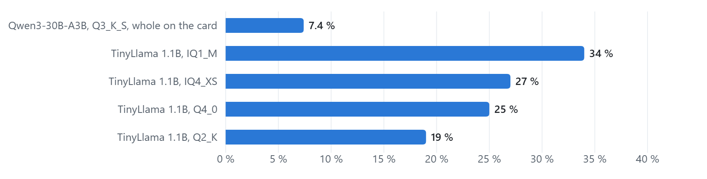
</picture>

Qwen3-30B-A3B at Q3\_K\_S, whole on the card: a decode token took 6.32 ms before and 5.85 ms after, in the same session (2026-11-15).

Table

| Model | Format | Before, ms | After, ms | Change, % |
| --- | --- | ---: | ---: | ---: |
| Qwen3-30B-A3B | Q3\_K\_S, whole on the card | 6.32 | 5.85 | −7.4 |
| TinyLlama 1.1B | IQ1\_M | — | — | −34 |
| TinyLlama 1.1B | IQ4\_XS | — | — | −27 |
| TinyLlama 1.1B | Q4\_0 | — | — | −25 |
| TinyLlama 1.1B | Q2\_K | — | — | −19 |

## The tests behind these numbers

Each test runs through the real engine on the card. A speed change that alters a single byte of output has to say so and pass the reference check above.

### The gate the engine passed on 2026-11-14

| Test | What it checks | Passed |
| --- | --- | ---: |
| `test_cuda_reference`(canary 1) | every model = the 4080's recorded output, teacher-forced (KL bar, top-1, a control that must fail) | 10/10 |
| `test_cuda_reference`(canary 2) | every model = the 4080's recorded output, teacher-forced (KL bar, top-1, a control that must fail) | 10/10 |
| `test_cuda_reference`(canary 3) | every model = the 4080's recorded output, teacher-forced (KL bar, top-1, a control that must fail) | 10/10 |
| `test_cuda_reference`(decode graph off) | every model = the 4080's recorded output, teacher-forced (KL bar, top-1, a control that must fail) | 10/10 |
| `test_cuda_reference`(old decode attention) | every model = the 4080's recorded output, teacher-forced (KL bar, top-1, a control that must fail) | 10/10 |
| `test_spec_checkpass` | speculative decoding's check pass = decode bit for bit; graph decode = plain decode bit for bit; replies = plain greedy | 9/9 |
| `test_gqa_decode_kernel` | the decode attention kernels against float64 on 7 shapes x 14 lengths, extremes, determinism | 10/10 |
| `test_tc_gemm` | the prompt's tensor-core matrices against exact sums, every weight format | 6/6 |
| `test_gqa_prefill_causality` | a prompt's attention never sees a later token | 3/3 |
| `test_quant_kernels` | every quantised weight format's kernel = gguf-py's dequantisation | 4/4 |
| `test_rolling_window` | replies past the context window: the cache's move and key rotation exact | 13/13 |
| `test_live_absorb_gpu` | text read into a loaded model through the real relay | 11/11 |
| `test_system_prompt_cache` | a cached system prompt = recomputing it | 11/11 |
| `test_bridge_server` | the app's runner answers end to end | pass |
| `test_qwen3moe` | a Qwen3-MoE twin = llama.cpp teacher-forced; streamed = whole bit for bit | 12/12 |
| `test_mla_flat` | DeepSeek's attention on the GPU = the exact path; batched = token by token | 5/5 |
| `test_mla_latent_kernel` | DeepSeek's absorbed attention kernels against float64 | 10/10 |
| `test_moe_gemm` | the grouped expert kernels against float64 | 15/15 |
| `test_gemma4_forward` | Gemma 4's own forward = llama.cpp | 5/5 |
| `test_expert_stream` | streamed experts = the whole model bit for bit | 5/5 |
| `test_shn5` | the lossless .shn5 format decodes to the GGUF's bytes; damage is caught | 10/10 |
| `test_backend_choice` | the engine picks a working GPU back end by itself | 10/10 |
| `test_qwen3moe_real` | Qwen3-30B-A3B BF16 streamed on the 16 GB card against a float64 reference | 4/4 |
| `test_cuda_reference`(canary on the live file) | every model = the 4080's recorded output, teacher-forced (KL bar, top-1, a control that must fail) | 10/10 |
| `test_spec_checkpass`(canary on the live file) | speculative decoding's check pass = decode bit for bit; graph decode = plain decode bit for bit; replies = plain greedy | 9/9 |
| `test_qwen3moe`(canary on the live file) | a Qwen3-MoE twin = llama.cpp teacher-forced; streamed = whole bit for bit | 12/12 |

### Since then

| Test | Area | What it checks | Passed | Date |
| --- | --- | --- | ---: | --- |
| `test_ltx_dit_engine`(full suite) | video engine | every kernel against float64; one block and all 48 against Lightricks' FP32 model; inside their pipeline, each guidance pass alone = its batched lane bit for bit; renders of the same video | 108 / 108 | 2026‑11‑17 |
| `test_ltx_dit_engine`, text to audio + video | video engine | the sound made on the engine for the first time: every lane's audio live, lanes bit for bit, picture and sound closer to FP32 than PyTorch | 16 / 16 | 2026‑11‑18 |
| the prompt-to-MP4 run, with a real render | video engine | a prompt in, an MP4 out with a picture and a sound that isn't silent | 16 / 16 | 2026‑11‑18 |
| `test_shn5_stage10` | .shn5 | Stage 10's bits against the ideal; the GPU decode = the CPU reference bit for bit; damaged files refused; a whole model's quality; streamed experts = the whole model bit for bit | 5 / 5 | 2026‑11‑16 |
| `test_weight_pack` | engine | a load's weights packed into chunks of at most 1 GiB, bit for bit on CUDA and Vulkan, all freed on release | 7 / 7 | 2026‑11‑15 |
| `test_spec_checkpass` | engine | after the new raw-format kernels: every multi-row twin = decode bit for bit on 7 formats | 9 / 9 | 2026‑11‑15 |

Method, hardware and flags

Card: NVIDIA GeForce RTX 4080, 16 GB, stock clocks; Ryzen 9 7950X; 128 GB DDR5 at 3,600 MT/s; Windows 11. The card's clock varies by hour, so a comparison counts only when both engines ran in the same session.

llama.cpp: its own llama-bench, build 983ca8992, `-ngl 99 -fa 1` (all layers on the card, flash attention on; every other setting at its default, such as 512-token micro-batches), 3 repetitions, its mean. Decode is `tg64` at the given depth; prompts are `pp512 / pp2048 / pp4096`.

Leviathan: the same model as a .lev file, loaded the way the app loads it. A prompt is one pass from position 0, the mean of three; decode is 64 steps after the prompt, the logits copied to the host each step and no sampling, as llama-bench does, the mean of two runs. Both engines ran in two interleaved rounds (llama.cpp, Leviathan, Leviathan, llama.cpp); each engine's faster round is shown, and the tables list both. The app's chat sends a prompt the same way, in one pass.

KL divergence: how far one next-token distribution is from another, in nats; 0 means identical. For scale, Leviathan's own two prompt paths (row by row, and on the tensor cores) differ by under 5e-5 on these models, except on Gemma 4's long document (9.5e-4).

.shn5: sizes are the files on disk, GB = 10⁹ bytes. The speeds are Qwen3-30B-A3B with its experts streamed from pinned RAM, 16 expert slots a layer on the card, the lossless and Stage 10 files alternated in one session. Quality: KL from a float64 reference built from the 30B's BF16 weights, with the embeddings and output head BF16 in both of its files; TinyLlama against its F16 model, teacher-forced.

Video: LTX-2.3 22B, a community FP8 checkpoint, its text encoded by Gemma 3; 1280 × 736, 113 frames (4.7 s at 24 fps), 8 denoising steps, Lightricks' 2.3 guidance (four passes a step), one reference image for the character, a given soundtrack (audio to video), seed 4242. PyTorch is Lightricks' own pipeline in bf16, its weights streamed from RAM. The engine's INT8 matrix products quantise both weights and activations to int8 after a per-row and per-column scale grid and a Hadamard rotation, with a rank-32 correction in fp16.

Sources: the 18 datasets behind this page

- **MoE model bigger than the card**: Qwen3-30B-A3B BF16 on the 16 GB RTX 4080: Leviathan's expert streaming against llama.cpp with its experts on the CPU, decode and prompt speed.
  - Model: Qwen3-30B-A3B-Instruct-2507, BF16 weights (61 GB as GGUF, 40.5 GB as Leviathan's lossless .shn5): larger than the 16 GB card, so experts are streamed
  - Card: NVIDIA GeForce RTX 4080 16 GB, PCIe 4.0 x16; Ryzen 9 7950X, 128 GB DDR5
  - Measured: Leviathan's decode and 700-token figures: 2026-11-14 \~03:00, after the shortened .shn5 decode chain (the engine DLL of that day; card clock sampled, 2,910 MHz median). Its 2,048-token figure and every llama.cpp figure: 2026-11-13 morning. Harness tests/engine/test\_qwen3moe\_real.py --arm; the same 700 token ids for both engines.
  - Where a range: llama.cpp's figures are the low and high of its repeated runs: the low is kept beside the high (the \_low fields)
  - Accuracy: Leviathan's fp32 prompt pass comes within 6.5e-5 nats of a float64 reference built from the model's own weights (worst case over the top-5 log-probs, a 700-token document)
  - Not shown: short prompts (\~20 tokens) are bounded by PCIe: \~30 tok/s against llama.cpp's 23-27
- **.shn5 file sizes**: Qwen3-30B-A3B as its BF16 GGUF, as a lossless .shn5 and as a Stage 10 q6 .shn5: the size on disk and bits a weight.
  - Model: Qwen3-30B-A3B-Instruct-2507: 128 experts x 48 layers, 8 used a token; the BF16 GGUF is 61.1 GB
  - Lossless: every decoded byte equals the GGUF's (checked tensor by tensor); exponents entropy-coded with rANS, sign + mantissa kept raw; 4,096-weight tiles, each with a checksum (2026-11-13)
  - Stage 10 (lossy): entropy-coded scalar quantisation: a per-row x per-column scale grid around one uniform step, then the same entropy coding; norms, router, embeddings and output head stay lossless; level q6 (2026-11-16)
  - Units: GB = 10^9 bytes; bits a weight averaged over the quantised matrices
- **.shn5 lossless and Stage 10, speed**: Qwen3-30B-A3B with its experts streamed from RAM, 16 slots a layer: decode, a 2,048-token prompt, the RAM held for the experts and the load time, both files in one session (2026-11-16).
  - Model: Qwen3-30B-A3B-Instruct-2507, experts streamed from pinned RAM, 16 expert slots a layer on the card
  - Measured: 2026-11-16, one session, the two files alternated (A/B): the card's clock varies by session, so compare within it. The 16.2 tok/s lossless figure above is an earlier session (2026-11-14)
  - Card: NVIDIA GeForce RTX 4080 16 GB (stock), Ryzen 9 7950X, 128 GB DDR5, Windows 11
- **Stage 10 and Q6\_K, quality**: Bits a weight and KL divergence from each model's reference for Stage 10 q6 and llama.cpp's Q6\_K, on Qwen3-30B-A3B and TinyLlama 1.1B (2026-11-16).
  - KL: how far each file's next-token distribution is from the reference, in nats; lower is closer
  - Calibration: the q6 level is set to Q6\_K's weight error on TinyLlama; on the 30B it lands a little further from the reference than Q6\_K at 6.8 % fewer bits: a per-model calibration is the next step
  - Measured: 2026-11-16; Leviathan's own engine loading each file the way the app does
- **Video engine, one change at a time**: Seconds to denoise one 1280 × 736, 113-frame LTX-2.3 shot: Lightricks' PyTorch pipeline, then Leviathan's video engine with each change added (2026-11-17).
  - Model: LTX-2.3, a 22-billion-parameter audio-video diffusion transformer (a community FP8 checkpoint), 48 blocks, the text encoder Gemma 3
  - Shot: 1280 x 736, 113 frames (4.7 s at 24 fps), 8 denoising steps, Lightricks' 2.3 guidance (4 passes a step), one reference image guiding the character, seed 4242, the music track frozen
  - Timing: seconds of DiT (the denoising), from each render's own recipe file, 2026-11-17; the whole render adds the text encoder, the decode and writing the file
  - Card: NVIDIA GeForce RTX 4080 16 GB (stock), Ryzen 9 7950X, 128 GB DDR5, Windows 11
- **Video engine against FP32, one step**: Relative error of one denoising step's picture and sound outputs from Lightricks' blocks run in FP32: the video engine's default and PyTorch's bf16 (2026-11-18).
  - What: one real denoising step, picture AND sound made from text (no track), 768 x 512 x 89 frames: each output's relative RMS error from Lightricks' blocks run in FP32 (weights x scale in float64) on the same inputs. Lower is closer
  - Leviathan: the engine's default (fp16 sums, fp16 attention, INT8 matrix products, the fused normalisation)
  - PyTorch: Lightricks' own bf16 pipeline on the same inputs
  - Measured: 2026-11-18, the engine's test suite (its text-to-audio-video section): 16 of 16 checks
- **Same video: PSNR against the exact engine**: PSNR of each render's frames against the exact engine's render of the same shot and seed, with another seed as the control (2026-11-17).
  - What: PSNR of every decoded frame against the exact engine's render of the same shot and seed: the same video sits in the 20s; a different seed (a different video) sits near 14.5. Higher is closer
  - Why not bit for bit: a diffusion model amplifies the last bit of any arithmetic over its steps, so no two maths paths match pixel for pixel; the frames show the same scene, man and motion
  - Measured: 2026-11-17, the 1280 x 736 shot above
- **One denoising step by part**: GPU time of one denoising step at 1280 × 736, by part, from a profiler trace (2026-11-17).
  - What: GPU kernel time of one denoising step (4 guidance passes) at 1280 x 736, 113 frames: 8.60 s, from a profiler trace
  - When: 2026-11-17, before the L2 prefetch, which then took about 0.35 s a step off the matrix products
- **Picture and sound from a prompt**: From a prompt to an MP4 with LTX-2.3's own sound on the video engine: clip length, denoising, decode and the whole run (2026-11-18).
  - What: a prompt in, picture AND sound out (LTX-2.3 makes its own audio, 48 kHz stereo), on the engine's default, Lightricks' 2.3 guidance for both the picture and the sound
  - Total: the whole run: the prompt read (cached), the engine built, the denoising, the decode and writing the MP4
  - Measured: 2026-11-18, NVIDIA GeForce RTX 4080 16 GB (stock), Ryzen 9 7950X, 128 GB DDR5, Windows 11
- **7B decode vs llama.cpp**: Qwen 2.5 Coder 7B Q8\_0 decode speed at three context lengths, both engines in one session over two interleaved rounds.
  - Model: Qwen 2.5 Coder 7B Instruct, Q8\_0 (the same GGUF for llama.cpp; Leviathan's .lev made from it)
  - Card: NVIDIA GeForce RTX 4080 16 GB, driver 617.42, stock clocks
  - llama.cpp: llama-bench, build 983ca8992 (CUDA), -ngl 99 -fa 1 (all layers on the card, flash attention on), every other setting at its default; 3 repetitions, their mean
  - Leviathan: engine DLL 61ca4057 (sha-256 prefix; live since 2026-11-14 15:52), loaded as the app loads it; prompts: one pass from position 0, the mean of 3; decode: 64 steps after the prompt, the logits copied to the host each step, no sampling, the mean of 2 runs
  - Rounds: two interleaved rounds (llama.cpp, Leviathan, Leviathan, llama.cpp) in one session; tok\_s = the engine's faster round, both rounds listed
  - Measured: 2026-11-14 15:57-16:00, one session, no other test or benchmark running
  - Log: tests/\_output/proof/compare.log (scripts final\_compare.sh / final\_compare.py)
  - Decode path: fp32 activations and fp32 KV cache; the step ran as a CUDA graph (389 graph steps in round 1), each running the grouped decode attention (Nsight Systems shows its kernel in every token: tests/\_output/proof/prof\_live.log)
- **7B prompt speed by setting**: Prompt speed at 512, 2,048 and 4,096 tokens: Leviathan's default and its two opt-in switches against llama.cpp, with each Leviathan setting's KL from its exact path.
  - Model: Qwen 2.5 Coder 7B Instruct, Q8\_0 (the same GGUF for llama.cpp; Leviathan's .lev made from it)
  - Card: NVIDIA GeForce RTX 4080 16 GB, driver 617.42, stock clocks
  - llama.cpp: llama-bench, build 983ca8992 (CUDA), -ngl 99 -fa 1 (all layers on the card, flash attention on), every other setting at its default; 3 repetitions, their mean
  - Leviathan: engine DLL 61ca4057 (sha-256 prefix; live since 2026-11-14 15:52), loaded as the app loads it; prompts: one pass from position 0, the mean of 3; decode: 64 steps after the prompt, the logits copied to the host each step, no sampling, the mean of 2 runs
  - Rounds: two interleaved rounds (llama.cpp, Leviathan, Leviathan, llama.cpp) in one session; tok\_s = the engine's faster round, both rounds listed
  - Measured: 2026-11-14 15:57-16:00, one session, no other test or benchmark running
  - Log: tests/\_output/proof/compare.log (scripts final\_compare.sh / final\_compare.py)
  - KL vs exact: the 2,048-token prompt's last position in each Leviathan arm against the exact path (LEVIATHAN\_TC\_GEMM=0: fp32 matrix-vector products a row at a time): KL(exact || arm) in nats
- **Reference check per model**: Each model's worst KL from the RTX 4080's recorded output over 4 prompts x 25 teacher-forced positions, with its bar.
  - What this is: tests/engine/test\_cuda\_reference.py: each model's output from today's engine, teacher-forced over 4 prompts x 25 positions (one prompt \~700 tokens, sent in the app's 256-token pieces), against the 4080's own CUDA output recorded on 2026-11-10. kl\_max = the worst KL divergence of any position. A model passes when the top token matches and KL stays under its bar at every position; a CONTROL (the same logits one step out of line) must fail, and did, 4 of 4, for every model.
  - What it is not: Not accuracy against an exact answer: the record was itself the fast path's output. It proves today's engine gives what the recorded one gave, across every engine change since and on every backend (Vulkan and an AMD iGPU pass the same check). Exactness is shown separately.
  - Bars: 1e-4, or twice CUDA's own spread between its fast and per-row paths where that is wider: only Gemma 4's long document (1.9e-3).
  - DeepSeek: 8.9e-5 comes from one near-tie row (margin 0.076 nats) in the code prompt; the cause is the attention's F16 copy of one weight (attn\_kv\_b), not the prompt path. Top-1 matches everywhere.
  - Measured: 2026-11-14, engine DLL 61ca4057 (live since 15:52): three runs in its gate before the swap (15:06-15:12) and once on the live file after it (15:52), the same worst KL for every model each time (tests/\_output/cand2/gate.log).
- **Cost of the opt-in switches**: Each model's worst KL from the stored reference with tensor-core attention or int8 matrices switched on.
  - What this is: The price of Leviathan's two OPT-IN speed switches, per model: the worst KL divergence from the stored CUDA reference over 4 prompts x 25 teacher-forced positions. The bar a model must pass is 1e-4.
  - tc attention: LEVIATHAN\_ATTN\_TC=1: the prompt's attention on fp16 tensor cores (fp32 sums). Measured 2026-11-14 on the sm\_89 test build lev\_ws6 (tests/\_output/attn\_tc/ref\_tc\_ws6.log). Gemma 4 and DeepSeek run their own attention, so it does not apply to them (null).
  - int8 GEMM: LEVIATHAN\_INT8\_GEMM=1: Q8\_0 weights times activations rounded to int8 per 32 values (llama.cpp's own precision class for prompts). Measured 2026-11-14 (tests/\_output/int8/ref\_int8.log). It only changes Q8\_0 models; the others show their default figure (int8\_applies false). Gemma 4 flips two top-1 tokens: never use it there.
  - Default: Neither switch is on by default: accuracy first (his call, 2026-11-14).
  - Models: Base architectures from the engine's blueprint of each file. DeepSeek-Coder-V2-Lite (Q6\_K, MoE + MLA) is in the reference set too; neither switch applies to it.
- **Decode step under the hood**: Kernels a decode token, matrix-vector time and attention time, from Nsight Systems traces of both engines.
  - Model and context: Qwen 2.5 Coder 7B Q8\_0 on the RTX 4080; decode at a 128-token context, the attention row at 4,096 tokens
  - Tool: NVIDIA Nsight Systems 2025.6.3, CUDA trace with --cuda-graph-trace=node for both engines (both replay their decode as CUDA graphs, which a plain trace collapses). Node tracing adds a little to every kernel, the same way for both.
  - Measured: 2026-11-14 16:04-16:05 back to back: llama-bench tg64 at d128 (-ngl 99 -fa 1), then Leviathan's live DLL 61ca4057, then llama-bench again (tests/\_output/proof/prof\_pair.log). The attention row: 16:00, 32 decode steps after a 4,096-token prompt (prof\_live.log). Leviathan 1.1.0's kernel count: 2026-11-14 \~12:40, before the launch fusion.
  - Attention bytes: 28 layers x keys and values x 4 KV heads x 128 dims x 4 bytes x \~4,120 positions = 472.5 MB a token; 382 GB/s = 57 % of the card's 670 GB/s read ceiling
- **Weight streaming speed**: How fast each weight of a decode step streams from video memory, against the card's measured read ceiling.
  - What this is: How fast each weight of a decode step streams from video memory: its bytes over its kernel's time (Nsight Systems), Qwen 2.5 Coder 7B Q8\_0 at a 128-token context.
  - The ceiling: 670 GB/s = the fastest a bare streaming-read kernel reached on this card (1 GiB, every block shape tried, best of 20; the RTX 4080's paper figure is 716.8). No matrix-vector product can stream faster than its weights load.
  - llama.cpp: Only the two weights whose llama.cpp launch could be told apart by its grid are listed for it. Its figures are its launches made outside CUDA graphs (its first tokens), traced exactly as Leviathan's were (Nsight Systems' plain CUDA trace). Its in-graph launches, traced node by node (which adds overhead per kernel), read 622 GB/s (gate + up) and 632 GB/s (LM head).
  - Measured: 2026-11-14 \~13:20 (tests/\_output/dense\_speed/prof/, the bw\_ceiling probe), Leviathan on its test build lev\_ws7: the same matrix-vector kernels as the live DLL 61ca4057 (whose traces at 16:00 and 16:04 put gate + up at 642 and 614 GB/s: the spread from one run to the next)
- **Raw-format decode kernels since 1.1.0**: Time a decode token takes before and after the raw-format matrix-vector kernels moved to two rows a warp (2026-11-15).
  - What: time a decode token takes, before and after the raw-format matrix-vector kernels moved to two rows a warp (2026-11-15), same session
  - Same output: KL &lt;= 4.2e-12 against the old kernels and the same top token on every row
  - Card: NVIDIA GeForce RTX 4080 16 GB (stock), Ryzen 9 7950X, 128 GB DDR5, Windows 11
- **Tests the live engine passed**: Each test in the gate the live engine DLL passed, what it checks, and how many of its checks passed.
  - What this is: The gate the live engine DLL (61ca4057) passed before it replaced the previous one, each test through the real engine on the RTX 4080 with the candidate picked by LEVIATHAN\_DLL; then the canary on the live file after the swap (the rows marked so).
  - Log: tests/\_output/cand2/gate.log (2026-11-14)
  - Left out: three old tests whose model file (a DeepSeek .lev in a folder since removed) no longer exists; they fail the same way on every build and are being repointed
- **Tests since the 2026-11-14 gate**: Each test run since the 2026-11-14 gate: what it checks and how many of its checks passed.
  - What: the tests run since the build in the table above (2026-11-14), each through the real engine on the card

Built with Claude Code by Michael Ricky Neal and Claude (Anthropic).
